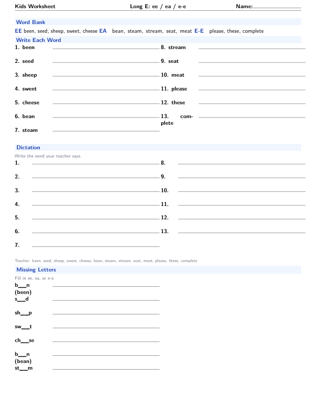

# Kids Worksheets

Printable worksheets for kids - math practice and phonics word tests.

Built with LaTeX for clean, professional output.

---

## Worksheets

### 1. Word Test: Long E Sounds

Practice words with **ee**, **ea**, and **e-e** (magic e) patterns.

**Words covered:** been, seed, sheep, sweet, cheese, bean, steam, stream, seat, meat, please, these, complete

**Activities included:**
- Word Bank and Writing Practice
- Traditional Dictation
- Missing Letters
- Jumbled Letters (Unscramble)
- Multiple Choice
- Sentence Completion
- Error Correction
- Word Shape Boxes

[Download PDF](worksheet-g2-wordtest-long-e.pdf)



---

### 2. Math: Under 100 (Addition and Subtraction)

Two-digit addition and subtraction problems with three difficulty levels:
- **No Carry/Borrow** - simple problems
- **Light Carry/Borrow** - one carry or borrow
- **Full Carry/Borrow** - more challenging

[Download PDF](worksheet-g2-u100.pdf)


---

### 3. Math: Advanced (Up to 200)

Harder problems for students ready for more:
- Two-digit problems up to 150
- Three-digit problems up to 200
- Multi-step problems (e.g., 45 + 30 - 15)

[Download PDF](worksheet-g2-advanced.pdf)


---

## Input Data (CSV Files)

All worksheet inputs are stored in the `data/` folder:

| File | Description |
|------|-------------|
| `data/words-long-e.csv` | Word list for long E sounds worksheet |
| `data/math-config.csv` | Configuration for math worksheets |

### words-long-e.csv columns

| Column | Description |
|--------|-------------|
| word | The spelling word |
| pattern | Sound pattern (ee, ea, e-e) |
| letters | Number of letters |
| example_sentence | Sample sentence using the word |
| missing_letters | Word with blanks for fill-in exercises |
| jumbled | Scrambled letters for unscramble exercises |
| misspelling | Common misspelling for error correction |

### math-config.csv columns

| Column | Description |
|--------|-------------|
| worksheet | Which worksheet file |
| section | Section number in the worksheet |
| difficulty | Difficulty level name |
| operation | Math operation (addition, subtraction, or both) |
| num1_min/max | Range for first number |
| num2_min/max | Range for second number |
| result_max | Maximum result value |
| pages | Number of pages to generate |

---

## How to Build (Optional)

If you want to customize or regenerate the worksheets, you need LaTeX installed.

```bash
# Install LaTeX (macOS)
brew install --cask mactex

# Build all worksheets
latexmk -pdf *.tex

# Build one worksheet
latexmk -pdf worksheet-g2-wordtest-long-e.tex

# Clean up build files
latexmk -c
```

---

## License

MIT - free to use, modify, and share.
