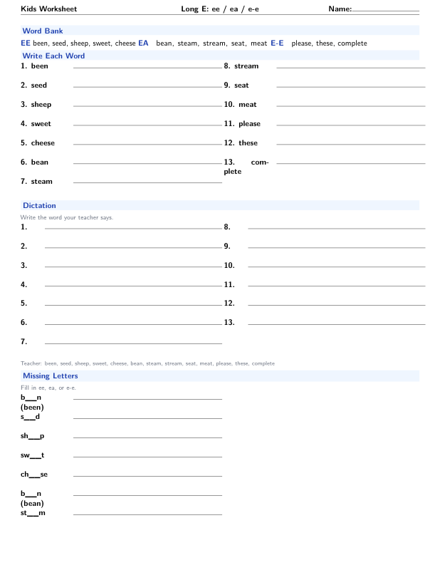
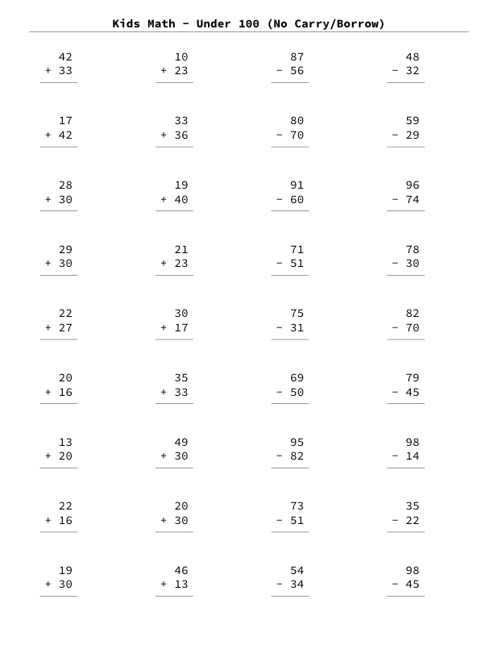

# Kids Worksheets

Printable worksheets for kids - math practice and phonics word tests.

Built with LaTeX for clean, professional output.

---

## Folder Structure

```
pdflatex/
  - src/           # LaTeX source files
  - pdf/           # Generated PDF worksheets
  - data/          # Input data (CSV)
  - preview/       # Preview images
```

---

## Worksheets

### 1. Word Test: Long E Sounds

Practice words with **ee**, **ea**, and **e-e** (magic e) patterns.

**Words:** been, seed, sheep, sweet, cheese, bean, steam, stream, seat, meat, please, these, complete

**Activities:** Word Bank, Writing Practice, Dictation, Missing Letters, Jumbled Letters, Multiple Choice, Sentence Completion, Error Correction, Word Shapes

[Download PDF](pdf/word-test-long-e.pdf) | [Source](src/word-test-long-e.tex)



---

### 2. Math: Under 100 (Addition and Subtraction)

Two-digit problems with three difficulty levels:
- No Carry/Borrow - simple problems
- Light Carry/Borrow - one carry or borrow
- Full Carry/Borrow - more challenging

[Download PDF](pdf/math-under-100.pdf) | [Source](src/math-under-100.tex)



---

### 3. Math: Advanced (Up to 200)

Harder problems for students ready for more:
- Two-digit problems up to 150
- Three-digit problems up to 200
- Multi-step problems (e.g., 45 + 30 - 15)

[Download PDF](pdf/math-advanced.pdf) | [Source](src/math-advanced.tex)


---

## Input Data (CSV Files)

| File | Description |
|------|-------------|
| `data/words-long-e.csv` | Word list for phonics worksheet |
| `data/math-config.csv` | Configuration for math worksheets |

---

## How to Build

Requires LaTeX (TeX Live or MacTeX).

```bash
# Build all worksheets
cd src
latexmk -pdf *.tex -outdir=../pdf

# Build one worksheet
latexmk -pdf word-test-long-e.tex -outdir=../pdf

# Clean build files
latexmk -c
```

---

## License

MIT - free to use, modify, and share.
