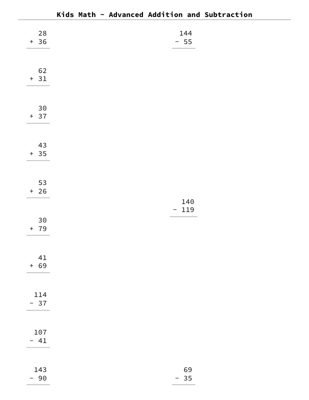

# Kids Worksheets

Printable worksheets for kids - math practice and phonics word tests.

Built with LaTeX for clean, professional output.

---

## Folder Structure

```
pdflatex/
  - src/                    # LaTeX source
  - src/math-under-100-common.tex   # Shared math-under-100 logic
  - pdf/                    # Generated PDF worksheets
  - data/                   # Input data (CSV)
  - preview/                # Preview images
```

---

## Worksheets

### 1. Word Test: Long E Sounds

Practice words with **ee**, **ea**, and **e-e** (magic e) patterns.

**Words:** been, seed, sheep, sweet, cheese, bean, steam, stream, seat, meat, please, these, complete

**Activities:** Word Bank, Writing Practice, Dictation, Missing Letters, Jumbled Letters, Multiple Choice, Sentence Completion, Error Correction, Word Shapes

[Download PDF](pdf/word-test-long-e.pdf) | [Source](src/word-test-long-e.tex)


---

### 2. Math: Under 100 (Addition and Subtraction)

Two-digit problems. Shared logic lives in `src/math-under-100-common.tex`; documents `\input` it and call the dynamic command.

**Dynamic command (one entry point):**
```latex
\MakeMathSheet{mode}{addOpts}{subOpts}{pages}{title}
```
- **mode:** `mixed` (add + sub) or `add` (addition only).
- **addOpts:** options for addition, e.g. `tens min=1, tens max=5, ones min=5, ones max=9, carry=1`.
- **subOpts:** options for subtraction (ignored if mode is `add`); for mixed use e.g. `tens min=2, tens max=9, borrow=0`.
- **pages:** number of extra pages (first page plus this many).
- **title:** header text, e.g. "Light Carry".

**Examples:**
```latex
\input{math-under-100-common}
% Mixed (add + sub), 10 pages total:
\MakeMathSheet{mixed}{tens min=1, tens max=4, carry=0}{tens min=2, tens max=9, borrow=0}{9}{No Carry/Borrow}
% Addition only, 5 pages:
\MakeMathSheet{add}{tens min=1, tens max=5, ones min=5, ones max=9, carry=1}{}{5}{Light Carry}
```

**Options (addOpts / subOpts):** `tens min`, `tens max`, `ones min`, `ones max`, `carry` (0 or 1), `borrow` (0 or 1).

[Download PDF](pdf/math-under-100.pdf) | [Source](src/math-under-100.tex)


---

### 3. Math: Advanced (Up to 200)

Harder problems for students ready for more:
- Two-digit problems up to 150
- Three-digit problems up to 200
- Multi-step problems (e.g., 45 + 30 - 15)

[Download PDF](pdf/math-advanced.pdf) | [Source](src/math-advanced.tex)



---

## Input Data (CSV Files)

| File | Description |
|------|-------------|
| `data/words-long-e.csv` | Word list for phonics worksheet |
| `data/math-config.csv` | Configuration for math worksheets (reference; Under 100 uses in-source options) |

---

## How to Build

Requires LaTeX (TeX Live or MacTeX).

```bash
# Build all worksheets
cd src
latexmk -pdf *.tex -outdir=../pdf

# Build one worksheet
latexmk -pdf word-test-long-e.tex -outdir=../pdf

# Math: type, pages, and carry/borrow from command line (run from repo root)
./build-math.sh add 5                        # add only, 5 pages, light_carry
./build-math.sh add 5 full_carry "Full Carry"
./build-math.sh mixed 9                       # mixed, no_carry, no_borrow
./build-math.sh mixed 9 light_carry light_borrow "Light Mixed"
./build-math.sh mixed 9 full_carry full_borrow "Full Carry/Borrow"
# Output: pdf/math-under-100-run.pdf (script writes src/math-build.cfg, then runs pdflatex)

# Carry presets: no_carry, light_carry, full_carry
# Borrow presets: no_borrow, light_borrow, full_borrow

# Or create src/math-build.cfg yourself for full control (see below), then:
#   cd src && pdflatex -jobname=math-under-100-run math-under-100-run.tex
```

**Dynamic config (`src/math-build.cfg`):** If this file exists, the runner `\input`s it. The file must contain a single line:

```tex
\MakeMathSheet{type}{addopts}{subopts}{pages}{title}
```

- **type:** `add` (addition only) or `mixed` (addition + subtraction)
- **addopts:** e.g. `tens min=1, tens max=5, ones min=5, ones max=9, carry=1`
- **subopts:** e.g. `tens min=3, tens max=9, borrow=1` (can be `{}` for add-only)
- **pages:** number of pages
- **title:** header text (e.g. `Light Carry`)

**Runner default** (when no config): `\MakeMathSheet{add}{tens min=1, tens max=5, ones min=5, ones max=9, carry=1}{}{5}{Math Sheet}`.

```bash
# Clean build files
latexmk -c
```

---

## License

MIT - free to use, modify, and share.
